<picture>
  <source media="(max-width: 600px)" srcset="./assets/hero-mobile.svg">
  
</picture>

<h1 align="center">Charlie James Abejo</h1>

  <strong>AI Developer &amp; Full-Stack Engineer</strong> 
  Philippines · Working globally

  I build AI systems, CRM workflows, APIs, and web and mobile applications 
  that turn business needs into practical, maintainable products.

  
  
  

  <a href="#selected-work">Selected work</a> &nbsp; / &nbsp;
  <a href="#technology-stack">Technology stack</a> &nbsp; / &nbsp;
  <a href="#uiux--design-systems">UI/UX &amp; design</a> &nbsp; / &nbsp;
  <a href="#open-source">Open source</a>

## Product thinking. Engineering ownership.

I work across architecture, data modeling, interfaces, integrations, deployment, and maintenance. My experience spans Australian client platforms, AI voice and automation, transport and delivery, CRM, point-of-sale, and operational systems.

I care about the complete experience: a clear user journey, secure access, dependable data flow, and a product the next engineer can understand and maintain.

| What I build | What that includes |
| --- | --- |
| **AI & voice systems** | LLM integrations, tool calling, streaming, structured output, voice workflows, and operational controls. |
| **CRM & automation** | Lead intake, omnichannel conversations, booking, retention, n8n workflows, and connected business tools. |
| **Web & mobile products** | Responsive interfaces, reusable components, operational dashboards, and real-time experiences. |
| **APIs & background workflows** | REST APIs, webhooks, durable queues, bounded retries, idempotency, data migration, and reconciliation. |

## Selected work

### 01 / OneRide Balingasag

**Transport, delivery, and local shopping in one platform.**

Built mobile, API, web, and administrative workflows for delivery, rides, scheduled pickups, and local-store orders. The system connects customer, rider, store, and admin experiences with live tracking and operational workflows.

`React Native` `Expo` `Go / Gin` `PostgreSQL` `WebSockets`

[View the Android app ↗](https://play.google.com/store/apps/details?id=com.oneridebalingasag.app) · [Read the case study ↗](https://portfoliobboy.vercel.app/#case-oneride)

### 02 / Zalio CRM

**A connected workspace for the member and lead lifecycle.**

Led the CRM module: SMS, WhatsApp, and email inbox workflows; response-time SLA alerts; lead deduplication; forms; retention workflows; browser calling; and calendar bookings.

`Next.js` `React` `TypeScript` `Twilio` `Realtime integrations`

[Explore the product ↗](https://zalio.ai/) · [Read the case study ↗](https://portfoliobboy.vercel.app/#case-zalio-crm)

Public product website. Client source code and the CRM interface are private.

### 03 / Alex + Hasti

**From a caller’s first enquiry to a connected CRM workflow.**

Built Alex’s self-hosted voice runtime and Hasti’s live callback experience, including request verification, live call status and captions, hang-up controls, consent capture, rate limits, and durable enquiry handoff.

`LiveKit Agents` `Twilio SIP` `Python` `n8n` `AI voice`

[Try the live callback demo ↗](https://hasti.com.au/) · [Read the case study ↗](https://portfoliobboy.vercel.app/#case-alex-hasti)

The portfolio’s US and Australian voice recordings are illustrative synthetic samples.

<strong>More product and engineering work</strong>

- **Enterprise CRM Platform** — retention and revenue dashboards, Twilio browser calling, data migration, and reconciliation. A separate private client system.
- **[GymFactories](https://gymfactories.com/)** — equipment research, manufacturer discovery, gym planning, and supplier enquiries.
- **Zalio Design System** — a shared component library and documentation site with theme, color, and motion tokens, an icon registry, and accessible component states.
- **Background processing and synchronization** — Python, Celery, Redis, PostgreSQL, bounded retries, replay-safe delivery, and source-of-truth reconciliation.

[Explore the full portfolio archive ↗](https://portfoliobboy.vercel.app/#projects)

## Technology stack

  
  
  
  
  
  
  
  
  

| Area | Technologies & practices |
| --- | --- |
| **AI & automation** | OpenAI API, Anthropic API, Claude Code, tool calling, streaming, structured output, MCP, n8n |
| **Frontend** | TypeScript, JavaScript, React, Next.js, TanStack Query, Zustand, Vue.js, Angular |
| **UI/UX & design systems** | Tailwind CSS, shadcn/ui, Base UI, reusable components, design tokens, theming, responsive layouts, accessible states, purposeful motion |
| **Backend & APIs** | Python, FastAPI, Django, Flask, Node.js, Express, Go / Gin, C# / .NET, PHP / Laravel |
| **Mobile & realtime** | React Native, Expo, Android, Java, Kotlin, Firebase, WebSockets, push notifications |
| **Data & infrastructure** | PostgreSQL, MySQL, Supabase, Neon, Redis, Docker, Linux VPS, Vercel, AWS Lambda |
| **Integrations & delivery** | REST APIs, webhooks, Twilio Voice, GoHighLevel, Git, GitHub, GitLab CI, Buddy CI/CD, Jenkins |
| **Testing & reliability** | Playwright, Celery, durable job queues, retries, idempotency, reconciliation, failure recovery |
| **Application security** | RBAC, JWT, OTP/2FA, row-level security, audit trails |

## UI/UX & design systems

<picture>
  <source media="(max-width: 600px)" srcset="./assets/design-mobile.svg">
  
</picture>

I approach design as part of engineering: how someone finds the next action, understands a state, recovers from an error, and moves through the product.

- **Reusable foundations** — color, typography, spacing, and motion tokens; consistent components and theme behavior.
- **Responsive experiences** — layouts that adapt to mobile and desktop, with readable content and usable controls.
- **Accessible interaction** — keyboard navigation, visible focus, descriptive labels, reduced-motion behavior, and understandable feedback.
- **Useful product states** — loading, empty, success, and error states that help people complete a task.

My portfolio demonstrates these ideas through expandable case studies, searchable projects, compact voice demos, and an optional interactive lab.

[Explore the portfolio experience ↗](https://portfoliobboy.vercel.app/)

## Open source

| Repository | Focus |
| --- | --- |
| **[meditrack](https://github.com/CharlieJamesGwapo/meditrack)** | Healthcare tracking system. |
| **[qado-automation](https://github.com/CharlieJamesGwapo/qado-automation)** | End-to-end automation for QADO Medisource using Playwright and TypeScript. |
| **[smsotp](https://github.com/CharlieJamesGwapo/smsotp)** | SMS OTP notifications with React and Go. |
| **[awesome-internet-cafe](https://github.com/CharlieJamesGwapo/awesome-internet-cafe)** | Curated tools for billing, captive portals, diskless boot, MikroTik, and monitoring. |
| **[awesome-apis-for-students](https://github.com/CharlieJamesGwapo/awesome-apis-for-students)** | Public APIs and practical ideas for student projects and capstones. |

<strong>How I work</strong>

- Model the workflow before choosing the stack.
- Keep API contracts, access boundaries, and data ownership clear.
- Build reusable interfaces with useful loading and failure states.
- Treat retries, idempotency, and reconciliation as part of integration design.
- Verify important user journeys with end-to-end tests.
- Document the decisions and recovery paths the next engineer will need.

## Let’s build something useful.

Open to **AI, full-stack, and backend development opportunities**, plus mobile, automation, and integration projects.

[View my work](https://portfoliobboy.vercel.app/) · [Connect on LinkedIn](https://www.linkedin.com/in/charlie-james-abejo-26362638a/) · [Email me](mailto:capstonee2@gmail.com)

---

Thoughtful interfaces. Reliable workflows. Software built to keep working.

